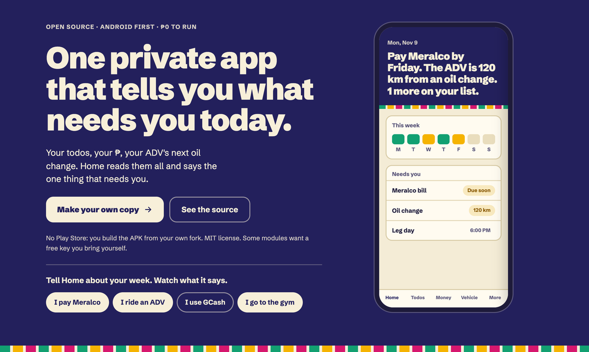
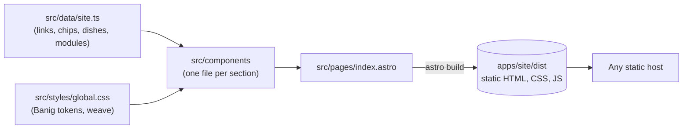

<div align="center">


# habi-site

### The website for Habi, one private app that tells you what needs you today.

*Habi* is Tagalog for "weave". The app weaves each part of your day into one Home.

**The landing page in Astro and the web app in Next.js, in one pnpm monorepo.**

[](https://github.com/charlitomecarez/habi-site/releases/tag/site-v1.0.0)
[](https://astro.build)
[](https://nextjs.org)
[](https://pnpm.io)
[](#how-the-site-works)

<br />

<code>pnpm install && pnpm dev:site</code>

</div>

> [!IMPORTANT]
> This repository holds the website only. The app itself lives in [charlitomecarez/my-app](https://github.com/charlitomecarez/my-app).
> The web app in `apps/web` is a Next.js template for now. The landing page in `apps/site` is the released part.

<div align="center">

<br />



<br /><br />

</div>

---

The landing page tells a visitor what Habi is and how to make their own copy. The hero plays a 26-second ad that walks through Home, Todos, Money, Vehicle and the Vault. The Home, Todos and Vault bands in the Tour play short HyperFrames loops, and the ad sources live in `ads/`. The page uses the same Banig look as the app: indigo, cream and woven colour fields.

> **[Read the release notes](https://github.com/charlitomecarez/habi-site/releases)** for each version of the site.

## Quick start

### Run the landing page

```sh
git clone https://github.com/charlitomecarez/habi-site.git
cd habi-site
nvm use          # Node 24, from .nvmrc
pnpm install
pnpm dev:site
```

The dev server prints the local URL. Stop the dev server when you finish.

### Build the landing page

```sh
pnpm build:site
```

Astro writes a static site to `apps/site/dist`. Any static host can serve that folder.

### Run the web app

```sh
pnpm dev:web
```

The web app is the `create-next-app` template. It has no features yet.

## How the site works



- **Static first.** Astro renders every section to HTML at build time. Small scripts add the hero demo, the chips, the tour motion and the ulam roll.
- **Works without JavaScript.** With JavaScript off, the page shows the finished state of every section and hides the controls that need it.
- **Respects reduce motion.** With reduce motion on, the hero phone shows one still frame and the tour bands do not animate.
- **Private by default.** The page has no analytics and makes no third-party requests. Schibsted Grotesk comes from `@fontsource` and is served with the site.

## What's inside

| Section                | What the visitor gets                                                                                    |
| ---------------------- | -------------------------------------------------------------------------------------------------------- |
| **Hero**               | The headline, Make your own copy, and a phone that plays Home. Chips let the visitor tell Home about their week |
| **A real life**        | Four facts that a general app can't join: any car or motorbike, GCash and MariBank, ulam under ₱99, Taglish voice notes |
| **Tour**               | Five bands: Home, Todos, Vault, Money and Vehicle. Each band plays its motion once, when it comes into view |
| **Ulam roll**          | Pick a limit, then roll a dish. It runs in the browser, with no account and no AI call                    |
| **Everything else**    | Every other module, grouped the way the app's More tab groups them. A gold corner marks a module that needs a key |
| **Private**            | How the vault, row-level security and on-phone data keep your life yours                                 |
| **₱0**                 | A receipt for one person's month: every service on its free plan                                        |
| **FAQ**                | Install, what stays on the phone, missing modules, iPhone                                                |
| **Make your own copy** | The four steps, the clone commands and a link to CONTRIBUTING.md in the app repo                              |

The page follows the system light or dark setting. It has a skip link and a visible focus ring on every link and button.

## FAQ

<details>
<summary><strong>Where is the app's code?</strong></summary>

In [charlitomecarez/my-app](https://github.com/charlitomecarez/my-app). This repository holds only the website.

</details>

<details>
<summary><strong>Why Node 24?</strong></summary>

Astro 7.4.7 needs Node 22.23.4 or later. `.nvmrc` says 24, so `nvm use` picks a version that works.

</details>

<details>
<summary><strong>Why does <code>pnpm-workspace.yaml</code> have <code>packageExtensions</code>?</strong></summary>

`@astrojs/astro2tsx` is built against `@emnapi/runtime` 1.11.3 but does not list it. Without the extension, pnpm gives it a 2.0 beta, and `astro check` crashes.

</details>

<details>
<summary><strong>Is the data on the page real?</strong></summary>

No. Every name, amount and reading on the page is example data.

</details>

## For developers

<details>
<summary><strong>Stack</strong></summary>

- `apps/site`: Astro 7, TypeScript, plain CSS with scoped component styles, and `@fontsource/schibsted-grotesk`.
- `apps/web`: Next.js 16 with the App Router, React 19, Tailwind 4 and TypeScript.
- pnpm 10.34.7 workspaces. The `packageManager` field in `package.json` sets the version.

</details>

<details>
<summary><strong>Commands</strong></summary>

Run these from the repository root.

| Command           | What it does                                                |
| ----------------- | ----------------------------------------------------------- |
| `pnpm dev:site`   | Starts the landing page dev server.                         |
| `pnpm build:site` | Builds the landing page into `apps/site/dist`.              |
| `pnpm dev:web`    | Starts the Next.js dev server.                              |
| `pnpm build:web`  | Builds the Next.js app.                                     |
| `pnpm lint`       | Runs `astro check` for the site and ESLint for the web app. |

Run `pnpm lint`, `pnpm build:site` and `pnpm build:web` before you open a pull request.

</details>

<details>
<summary><strong>Project layout</strong></summary>

- `apps/site/src/pages/index.astro`: the landing page. It puts the sections in order.
- `apps/site/src/components/`: one file for each section, with its own styles and script.
- `apps/site/src/data/site.ts`: the links, the hero chips, the dishes and the module groups.
- `apps/site/src/styles/global.css`: the Banig tokens for the light and dark themes, the weave and the shared buttons.
- `apps/site/public/`: the favicon.
- `apps/web/`: the Next.js template.
- `docs/images/`: the images for this README.
- `.impeccable/`: design critique snapshots from Impeccable.

</details>

<details>
<summary><strong>Branches and releases</strong></summary>

- `main` is the default branch. Make changes on a branch and open a pull request into `main`.
- Each app has its own tags. A landing page release uses `site-vX.Y.Z`, for example [`site-v1.0.0`](https://github.com/charlitomecarez/habi-site/releases/tag/site-v1.0.0).
- Change the version in `apps/site/package.json` in the same pull request as the release.

</details>

## Documentation

- [Habi README](https://github.com/charlitomecarez/my-app#readme): what the app does.
- [Habi CONTRIBUTING.md](https://github.com/charlitomecarez/my-app/blob/main/CONTRIBUTING.md): set up your own copy of the app.
- [Habi design system](https://github.com/charlitomecarez/my-app/blob/main/docs/design-system.md): the Banig tokens that the site uses.
- [Releases](https://github.com/charlitomecarez/habi-site/releases): every release of the site.

## License

This repository has no license file yet. The Habi code is [MIT](https://github.com/charlitomecarez/my-app/blob/main/LICENSE).
